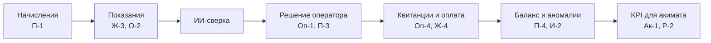

# Пользовательские сценарии по ролям

38 сценариев пилотной версии Esepshy. У каждого сценария есть код, основной ход и критерий приёмки.

Рабочая версия документа с комментариями: [Claude Docs](https://claude.ai/code/artifact/5a1a07c9-62e9-400c-bd52-2395e39e1ffa). Этот файл — копия на 11.10.2026.

## Формат и принятые решения

- **Код сценария** = буква роли + номер (Ж-1, П-2…). По коду сценарии связываются с макетами, задачами разработки и тест-кейсами.
- **Основной ход** — шаги без ошибочных веток. Ошибки и исключения описываются при детализации.
- **Критерий приёмки** — что проверяется при сдаче пилота.
- **Вход жителя:** через eGov (ЭЦП / eGov Mobile). В пилоте — тестовый режим: имитация экрана eGov, вход по тестовому ИИН. Модуль авторизации отделён для перехода на боевой eGov без переделки платформы.
- **Вход сотрудников:** логин и пароль организации; для администратора — с двухфакторной проверкой.
- **Персональные данные:** акимат и аудитор видят данные по домам и районам без ФИО и номеров ЛС.

## Житель

| Код | Сценарий | Основной ход | Критерий приёмки |
| --- | --- | --- | --- |
| Ж-1 | Вход через eGov | «Войти через eGov» → в тестовом режиме тестовый ИИН → система находит ЛС по связке ИИН — адрес → главный экран | Не больше 3 шагов; жителю с несколькими ЛС показан список адресов |
| Ж-2 | Посмотреть квитанцию | Выбирает ЛС → видит строки по поставщикам: объём, основание (счётчик или норматив), тариф, сумма, долг, НДС | Сумма квитанции совпадает с суммой строк и долга; у каждой строки указан поставщик |
| Ж-3 | Передать показания | Вводит показания по счётчикам без автопередачи → проверка: не меньше прежнего, расход в разумных пределах → сохранение | Показание меньше прежнего не принимается; при резком росте — предупреждение и подтверждение |
| Ж-4 | Оплатить онлайн | «Оплатить» → вся сумма или часть → оплата через банк-агента → подтверждение | Платёж отражается в ЛС и в KPI «Платежи онлайн» после подтверждения банка |
| Ж-5 | Оспорить начисление | «Не согласен» в строке → причина (нет счётчика / неверная площадь / уже оплачено / другое) → фото → отправка | Обращение в очереди оператора с привязкой к строке; житель видит статус и ответ |
| Ж-6 | История платежей и начислений | «История» → начисления, оплаты и корректировки за 12 месяцев | Каждая корректировка показана с причиной и датой |

## Поставщик ресурса

| Код | Сценарий | Основной ход | Критерий приёмки |
| --- | --- | --- | --- |
| П-1 | Загрузить начисления за месяц | Файл по шаблону (Excel/CSV) или API → проверка формата, сопоставление с ЛС → отчёт: принято, отклонено, не найдено | Строки с ошибкой не попадают в квитанции; отчёт можно скачать |
| П-2 | Обновить тарифы | Тариф, дата начала, основание (номер приказа) → изменение в журнале | Новый тариф только к периодам с даты начала; старый в истории |
| П-3 | Ответить на корректировку | Уведомление о корректировке → основание → принять или подать возражение | Возражение возвращает расхождение оператору; решение в журнале |
| П-4 | Отработать аномалии учёта | Список небалансов по своим домам → выезд инспектору → результат → закрытие | По каждой закрытой аномалии есть результат; потери дома пересчитаны |

## ОСИ / КСК / управляющая компания

| Код | Сценарий | Основной ход | Критерий приёмки |
| --- | --- | --- | --- |
| О-1 | Выставить взносы ОСИ | Ставка за м² и период → строка «Взносы ОСИ» в квитанциях домов | Строка в квитанциях следующего периода; ставка в истории |
| О-2 | Передать показания ОДПУ | Вносит или подтверждает показания общедомовых счётчиков → баланс дома | Баланс «ввод — сумма квартир» пересчитан в течение суток |
| О-3 | Посмотреть состояние дома | Карточка дома: потери, доля умных счётчиков, аномалии, доля оплат | Показатели совпадают со сводкой ЕРЦ по дому |
| О-4 | Работать с должниками дома | Список должников: сумма, срок, сегмент → напоминание | Только через шаблон; отправка в журнале |

## Инспектор

| Код | Сценарий | Основной ход | Критерий приёмки |
| --- | --- | --- | --- |
| И-1 | Получить список выездов | Выезды на день: адрес, тип аномалии, ресурс | Только выезды этого инспектора |
| И-2 | Зафиксировать результат | Результат (утечка / обход / неисправный счётчик / нарушений нет) → фото → показание → отправка | Без фото и показания не отправляется; время и место сохраняются |
| И-3 | Передать заявку на устранение | Заявка поставщику или ОСИ с описанием | Заявка со ссылкой на аномалию |

## Оператор сверки (ЕРЦ)

| Код | Сценарий | Основной ход | Критерий приёмки |
| --- | --- | --- | --- |
| Оп-1 | Разобрать очередь расхождений | Очередь по уверенности модели и сумме → тип, ЛС, поставщик, объяснение → подтвердить или отклонить | Не больше 3 кликов; решение в журнале с автором и временем |
| Оп-2 | Отметить ложное срабатывание | Отклонить → причина → случай в выборку для дообучения | Доля ложных в отчёте; отклонённые не входят в KPI ошибок |
| Оп-3 | Ответить на жалобу жителя | Обращение из Ж-5 → проверка строки → корректировка или отказ с объяснением | Житель получает ответ; срок отслеживается |
| Оп-4 | Проверить квитанции до рассылки | Проверка периода → выпуск, когда нет открытых критичных расхождений | Квитанции не уходят при открытых расхождениях выше порога |

## Специалист по задолженности (ЕРЦ)

| Код | Сценарий | Основной ход | Критерий приёмки |
| --- | --- | --- | --- |
| Д-1 | Напоминания низкому риску | Сегмент «Низкий риск» → шаблон WhatsApp/SMS → рассылка | Только должникам сегмента; статус доставки по каждому ЛС |
| Д-2 | Оформить рассрочку | ЛС среднего риска → график → согласие жителя → график в квитанциях | Платежи по графику отдельно; при пропуске ЛС возвращается в очередь |
| Д-3 | Досудебная претензия | ЛС высокого риска → претензия по шаблону с расчётом → проверка и выгрузка | Расчёт долга по периодам; факт отправки фиксируется |
| Д-4 | Отследить результат | Отчёт по сегментам: погашено, переход между сегментами | Ожидаемый сбор за 90 дней сравнивается с фактическим |

## Руководитель ЕРЦ

| Код | Сценарий | Основной ход | Критерий приёмки |
| --- | --- | --- | --- |
| Р-1 | Контролировать расчётный цикл | Панель периода: загрузка начислений, сверка, готовность квитанций, рассылка | Видно, кто не загрузил данные и сколько расхождений открыто |
| Р-2 | Смотреть KPI пилота | Онлайн-платежи, ошибки на 1 000 счетов, умные счётчики, потери — против целей | Каждый KPI с целью, базой и динамикой по месяцам |
| Р-3 | Нагрузка операторов | Разобрано по операторам, среднее время решения | Отчёт за период, выгрузка в Excel |

## Администратор платформы

| Код | Сценарий | Основной ход | Критерий приёмки |
| --- | --- | --- | --- |
| А-1 | Завести организацию и пользователей | Организация → зона (ресурс, дома, район) → сотрудники с ролями | Сотрудник видит только свою организацию и зону |
| А-2 | Изменить или отозвать доступ | Смена роли или блокировка | Действует со следующего запроса; запись в журнале |
| А-3 | Вести справочники | Дома, адреса, типы счётчиков, шаблоны сообщений | Изменения версионируются |
| А-4 | Следить за интеграциями | Статус обмена с банками, поставщиками, eGov | Ошибка видна в течение 15 минут, уходит уведомление |

## Акимат

| Код | Сценарий | Основной ход | Критерий приёмки |
| --- | --- | --- | --- |
| Ак-1 | Сводка пилота | KPI пилота против целей из задачи акимата | Совпадает со сводкой ЕРЦ; персональных данных нет |
| Ак-2 | Найти проблемные дома | Сортировка по потерям, долгу, доле оплат → карточка дома | Карточка без данных жителей |
| Ак-3 | Отчёт для акима | Период → выгрузка PDF или Excel | Формируется за минуты |
| Ак-4 | Сравнить с базой пилота | «До пилота» и «сейчас» по каждому KPI | База, текущее значение и цель по каждому KPI |

## Аудитор

| Код | Сценарий | Основной ход | Критерий приёмки |
| --- | --- | --- | --- |
| Ау-1 | Проверить журнал действий | Фильтр по периоду, пользователю, типу действия → выгрузка | Все изменения начислений, тарифов, ролей и доступа; журнал неизменяем |
| Ау-2 | Проследить корректировку | Цепочка: находка модели → решение оператора → ответ поставщика → итог в квитанции | Цепочка восстанавливается по любой корректировке |

## Сквозной месячный цикл

Квитанции выпускаются только после ИИ-сверки и решения оператора. Возражение поставщика (П-3) возвращает расхождение оператору до выпуска квитанций.

## Открытые вопросы

- [ ] Инспектор: отдельная роль с мобильным интерфейсом в пилоте или во второй очереди?
- [ ] Банк-агент: подтвердить, что это интеграция по API, а не пользователь системы
- [ ] Возражение поставщика (П-3): кто принимает окончательное решение — оператор или руководитель ЕРЦ?
- [ ] Связка ИИН — лицевой счёт для входа через eGov: из каких данных она берётся
- [ ] Шаблон загрузки начислений (П-1): согласовать формат с поставщиками пилотных домов
